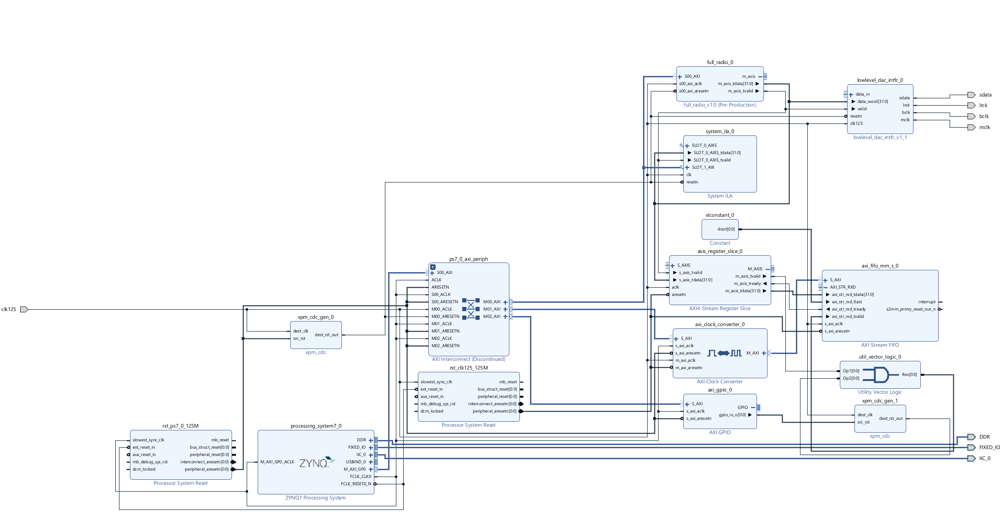

# Software Defined Radio on ZYBO Z7

📡 A complete **Software Defined Radio (SDR)** implemented on the **Zybo Z7 (Zynq-7000)** FPGA + ARM SoC platform.  
This project integrates **FPGA-based DSP, AXI interconnects, Linux on ARM, and a web interface** to create a tunable real-time radio system with audio output.  

---

## 🔎 System Overview

1. **Signal Acquisition**  
   - Input sampled via **ADC AD9467** interface.  
   - Data enters FPGA programmable logic (PL).  

2. **Frequency Tuning**  
   - Tuning signal generated by **DDS (Direct Digital Synthesizer)**.  
   - Frequency selected via a **web interface** served by the PS (ARM core) running Linux + `httpd -p 8080`.  
   - PS communicates tuning data to the **Complex Multiplier** over **AXI interconnect/AXI-Stream/AXI-GPIO**.  

3. **Digital Downconversion (DDC)**  
   - Complex multiplier mixes input signal with DDS.  
   - Outputs fed into **two-stage FIR_compiler** (separate for real and imaginary paths).  
   - Decimation applied (fractional rate, `2^37` in this configuration).  

4. **Digital-to-Analog Output**  
   - Real signal → upper 16 bits of DAC input.  
   - Complex signal → lower 16 bits of DAC input.  
   - Output routed through **DAC interface → CODEC** via `sdata`, `lrck`, `bclk`, `mclk`.  
   - Final audio delivered on **Zybo Z7 audio jack**.  

---

## 🖥️ Block Diagram

  
*(Vivado block diagram of the Zynq-7000 PS + PL integration)*  

---

## ✨ Features

- Real-time SDR pipeline from **ADC → FPGA DSP → DAC → Audio output**  
- **Web-based tuner** (control radio frequency via browser over LAN)  
- FPGA-accelerated DSP:
  - Complex multiplication  
  - Multi-stage FIR filtering  
  - Decimation for bandwidth reduction  
- Integration of **Linux user space + ARM PS + FPGA PL** via AXI  
- Output through onboard **audio CODEC + headphone jack**  

---

## 🚀 Technologies

- **Hardware**: Xilinx Zybo Z7 (Zynq-7000 SoC), AD9467 ADC, onboard DAC/CODEC  
- **FPGA Design**: Vivado IP Integrator, Verilog/VHDL, FIR Compiler, AXI Interconnect  
- **Software**: Linux (Petalinux on Zynq PS), `httpd` for web control  
- **Interfaces**: AXI-Stream, AXI-GPIO, AXI4-Lite, DDR, I²S Audio  
- **Languages**: Verilog, C, Python (optional for web UI)  

---

## 🛠️ Getting Started

### Prerequisites
- Xilinx Vivado (2024.2 or later recommended)  
- PetaLinux for Zynq PS boot image  
- Zybo Z7 board + AD9467 interface  

### Steps
1. Clone the repository:
   ```bash
   git clone git@github.com:Suke2004/RTL_SDR_FPGA.git
   cd RTL_SDR_FPGA
   ```

2. Run `make_project.bat` (Windows) or `make_project.sh` (Linux) to build the project all the way through SD card creation.

3. **Copy the Web Package**  
   Copy "sdr_files\src\web.zip" to your Zybo board.  
   *The location is flexible — you may place it on the SD card or in the temporary RAM filesystem.*

4. **Extract the Archive**  
   Run the following command to extract the files:  
   ```bash
   unzip web.zip
   ```  
   This creates a `web` directory in your current path.

5. **Start the Webserver**  
   Change into the `web` directory and start the built-in webserver:  
   ```bash
   cd web
   sudo httpd -p 8080 .
   ```  
   Your Zybo will now serve webpages. Access them from a browser at:  
   ```
   http://<your_zybo_ip>:8080
   ```

6. **Initialize the Radio**  
   Inside the `web` directory is the default bitfile (bit.bin file) from my completed project. 
   - Clicking **Initialize PL/Radio** runs `fpgautil` to configure the PL with this design.  
   - It also runs the `configure_codec` script.  
   - After you complete your hardware, you can replace this bitfile (`bit.bin`) with your own.

7. **Configure Frequencies**  
   When the user enters frequencies and clicks **Submit**, a Python script in the `cgi-bin` directory is executed.  
   - The script receives the frequency values entered in the form.
   
8. **You should hear your tuned radio output from the AUX out!**